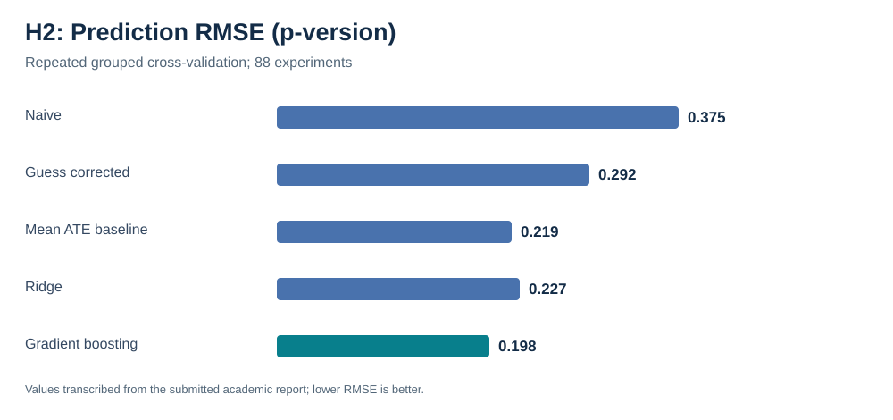
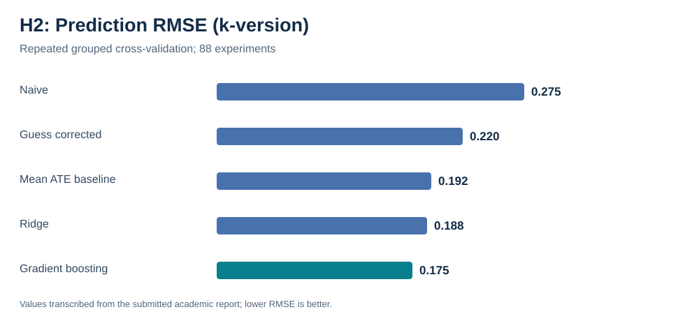
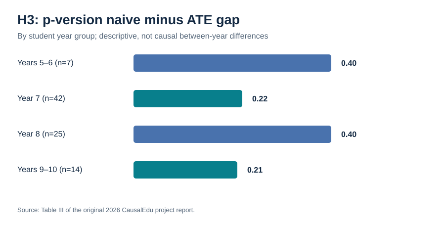
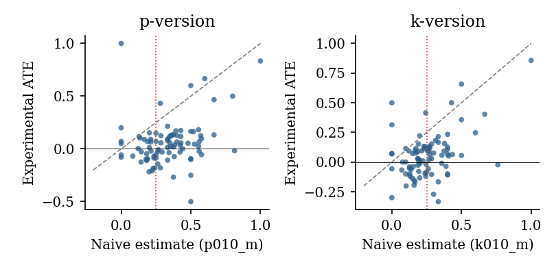
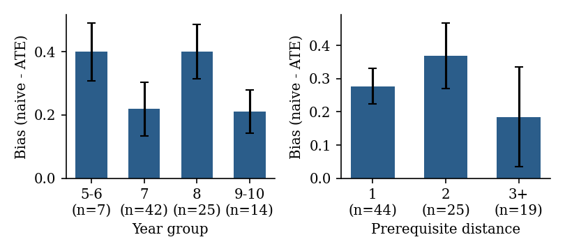
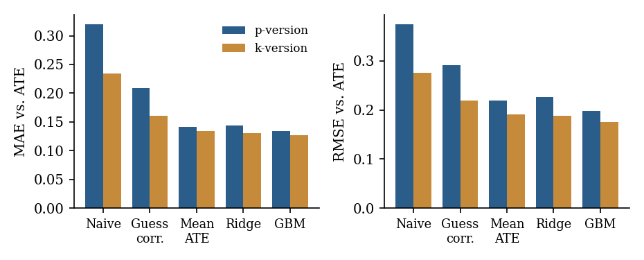
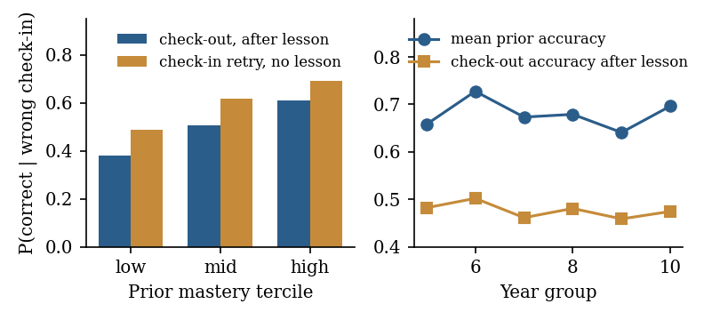

# CausalEdu — Learning Analytics & Causal Inference

### Why naive pre/post lesson gains can disagree with randomized treatment effects

**Bejawada Shekhar** · **26m1032** · M.Tech Educational Technology · IIT Bombay

[](https://www.python.org/)  

> **Research question:** How do observational measures of lesson improvement compare with A/B-test average treatment effects (ATEs), and can learning-history features explain or predict their differences?

## Overview

A student's check-out answer may be more accurate than their earlier check-in answer, but that improvement **does not establish** how much the lesson itself caused. Using [Eedi's CausalEdu dataset](https://github.com/Eedi/CausalEdu), this project compares naive observational estimates against randomized experimental results from **88 experiments**, evaluates alternative ATE predictors and analyzes subgroup patterns. **It does not estimate individual treatment effects** from learner-level randomized assignments.

## Findings at a glance

| Measure | p-version | k-version |
|:--|--:|--:|
| Mean naive observational estimate | 0.340 | 0.260 |
| Mean randomized ATE | 0.057 | 0.056 |
| Mean naive minus ATE gap | **0.283** | **0.203** |
| Experiments with a positive gap | 92% | 90% |
| Naive estimate RMSE | 0.375 | 0.275 |
| Gradient boosting RMSE | 0.198 | 0.175 |

> **Interpretation:** Naive metrics are much higher than randomized ATEs, but these are *different estimands*, so the entire gap cannot be labeled causal bias. Even the best predictive model did not demonstrate a statistically clear improvement over a constant mean-ATE benchmark.

## Research hypotheses

| Hypothesis | Question | Conclusion |
|:--|:--|:--|
| **H1** | Do naive pre/post estimates exceed randomized ATEs? | **Supported** as a systematic descriptive gap |
| **H2** | Do guessing correction and covariate-based predictors improve ATE prediction? | **Partially supported**; improvements over naive estimates, not clear over a constant-ATE baseline |
| **H3** | Are gaps associated with learner year groups and prerequisite distance? | **Partially supported**; year-group differences, no clear distance association |

[Detailed hypotheses, evidence and statistical interpretation](HYPOTHESES.md) · [Final research report (PDF)](report/final_report.pdf) · [GitHub-readable research report](report/FINAL_REPORT.md)

## Visual evidence

### H2: Prediction errors by estimator

The following two figures show root mean squared error (RMSE) of different estimators; **lower is better**.





### H3: Subgroup patterns



### Four original research figures

These are the original figures extracted from the submitted research report (rather than charts recreated from summary tables).

| Figure | Research focus |
|:--|:--|
| [Figure 1](figures/original_figure_1.png) | Naive observational estimates versus randomized ATEs (H1) |
| [Figure 2](figures/original_figure_2.png) | Differences by year group and prerequisite distance (H3) |
| [Figure 3](figures/original_figure_3.png) | Cross-validated estimator performance (H2) |
| [Figure 4](figures/original_figure_4.png) | Prior mastery, no-lesson retry and check-out patterns |









[Download the final academic report](report/final_report.pdf) · [Download the illustrated portfolio report](report/portfolio_report.pdf).

## Repository structure

```text
LA_project/
├── README.md                         # Start here
├── HYPOTHESES.md                     # H1-H3: evidence and conclusions
├── METHODOLOGY.md                    # Research pipeline and dataset instructions
├── CONTRIBUTING.md
├── requirements.txt
├── .gitignore
├── code/
│   ├── analysis.py                   # Analysis and figure generation
│   └── build_report.py               # PDF report generation from outputs
├── report/
│   ├── final_report.pdf              # Submitted report PDF
│   ├── portfolio_report.pdf          # Illustrated portfolio edition
│   └── FINAL_REPORT.md               # Research report readable on GitHub
├── figures/                          # Four original published analysis figures
│   ├── original_figure_1.png
│   ├── original_figure_2.png
│   ├── original_figure_3.png
│   └── original_figure_4.png
└── visualizations/                   # Three lightweight SVG evidence charts
```

The original dataset and generated `results/` are not committed. The four original report figures are available in `figures/`. When rerunning the analysis, the script also generates its own figure files in that folder.

## Reproduce the analysis

**Python:** 3.11 recommended. The research dataset must be obtained from the original publisher; it is not included in this repository.

```bash
git clone https://github.com/Shekharbejawada925/LA_project.git
cd LA_project

python -m venv .venv
# macOS / Linux:
source .venv/bin/activate
# Windows PowerShell:
# .venv\Scripts\Activate.ps1

pip install -r requirements.txt
```

Download the data from [Eedi/CausalEdu](https://github.com/Eedi/CausalEdu) and place these five source CSVs in a local folder named `data/`:

```text
data/
├── checkins_lessons_checkouts_training.csv
├── student_metadata.csv
├── construct_experiments_ates_test.csv
├── checkin_to_checkout.csv
└── construct_prerequisites_test.csv
```

Run the following commands from the repository root:

```bash
python -I code/analysis.py data .
python -I code/build_report.py .
```

**Outputs:** CSV/JSON tables under `results/`, original research PNGs under `figures/`, and a regenerated PDF at `report/final_report.pdf`. The committed reports remain unchanged unless you deliberately run the report generator and commit its output. The script fixes a random seed but exact reproduction still depends on the dataset release and package versions.

## Methods and limitations

The pipeline reconstructs prior learner history using time-ordered event logs, builds construct and lesson-level predictors, compares observational summary statistics with randomized experiments, assesses models through grouped cross-validation, and analyzes heterogeneity by year and prerequisite graph distance.

Key limitations include only 88 experiments, noise in experimental ATEs, repeated related lesson/question pairs, different observational and experimental estimands, and non-random lesson coverage by year group. See [METHODOLOGY.md](METHODOLOGY.md) for more detail.

## Author

**Bejawada Shekhar (26m1032)** — research design, feature engineering, statistical analysis, model comparisons, visualizations and report preparation, as confirmed for the revised portfolio version.

## Credits and usage

Dataset: [Eedi / CausalEdu](https://github.com/Eedi/CausalEdu). Original data rights and citation requirements are governed by the publisher. This is an academic research portfolio, **not** a production lesson-effect prediction service. No software license is granted by default.
