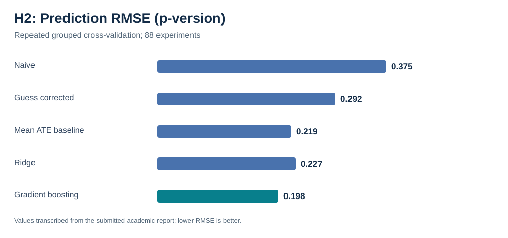
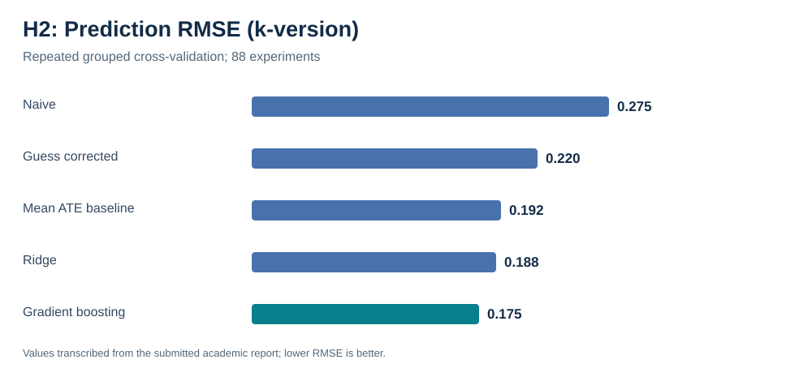
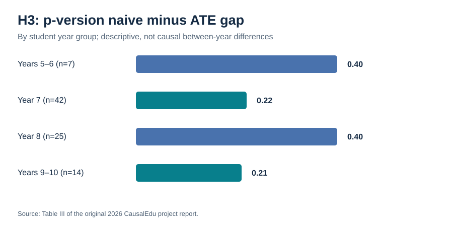

# Final Research Report — CausalEdu

**Author:** Bejawada Shekhar (26m1032)  
**Institution:** Indian Institute of Technology Bombay  
**Course:** ET601  
**Research period:** October 2026  
**Project:** Naive Pre/Post Lesson Estimates Overstate Learning Gains: Evidence from the CausalEdu A/B Tests

> This Markdown edition gives a GitHub-readable account of the revised sole-author report. The complete illustrated 8-page PDF and 10-page portfolio PDF were prepared separately and are not yet stored in this repository.

## Abstract

Online learning systems often use changes between check-in and check-out answers to evaluate lessons. Such changes do not necessarily measure what the lesson caused. This study compares observational pre/post summary rates with randomized A/B-test average treatment effects (ATEs) using the CausalEdu dataset from Eedi. The submitted analysis covers 641,490 quiz events, 10,044 students and 88 randomized experiments. It finds a substantial positive gap between the observed conditional success metrics and randomized effects, evaluates guessing correction and predictive models, and explores variation by year group and prerequisite graph distance.

## 1. Problem statement and objective

Observational gains may combine treatment responses with prior knowledge, practice, regression to the mean, selection, and guessing. The question is whether the measured gain would still occur without the intervention.

**Objective:** Quantify the observational–experimental difference, evaluate candidate corrections against observed ATEs, and characterize heterogeneity without mistaking predictive association for a causal intervention effect.

## 2. Dataset and methodology

Source: [Eedi's CausalEdu data](https://github.com/Eedi/CausalEdu). The research pipeline processes time-ordered event histories, student metadata, lesson/check-in/check-out matches, expert prerequisite edges, and randomized experiment outcomes. It links observational constructs to the 88 A/B experiments and creates learner-history, construct-level, and lesson-related attributes.

H1 uses paired naive-minus-randomized effect differences with confidence intervals. H2 compares raw observational estimates, analytical guessing correction, the mean-ATE benchmark, ridge regression, and gradient boosting under grouped cross-validation. H3 compares year groups and expert prerequisite graph distances; supporting analyses summarize learner mastery before an event.

## 3. Research hypotheses and findings

### H1 — Observed gains overstate randomized effects

The mean naive estimates were **0.340 (p-version)** and **0.260 (k-version)**; the mean randomized ATEs were **0.057** and **0.056**. Mean differences were **0.283** (95% CI **0.230–0.336**) for p and **0.203** (95% CI **0.163–0.241**) for k. The naive estimate exceeded the randomized effect in **92%** of experiments for p and **90%** for k.

**Conclusion:** H1 is supported as a systematic *difference between these measures*. It is not valid to treat the entire gap as solely causal bias, because the observational and experimental quantities are not identical estimands.

### H2 — Corrected predictors better estimate ATE

| Method | p RMSE | k RMSE |
|---|---:|---:|
| Naive observational rate | 0.375 | 0.275 |
| Guessing correction | 0.292 | 0.220 |
| Mean-ATE benchmark | 0.219 | 0.192 |
| Ridge | 0.227 | 0.188 |
| Gradient boosting | **0.198** | **0.175** |

**Conclusion:** H2 is partially supported. Gradient boosting lowers prediction errors compared with the naive and guessed-corrected methods, but does **not** show statistically conclusive improvement over simply predicting the mean randomized ATE. This is not a validated production estimator.

### H3 — Differences depend on student characteristics and prerequisites

| School-year group | Experiments | p-version mean difference |
|---|---:|---:|
| 5–6 | 7 | 0.40 |
| 7 | 42 | 0.22 |
| 8 | 25 | 0.40 |
| 9–10 | 14 | 0.21 |

Year-group terms were jointly associated with the observed gap (reported p = .009 for p and p < .001 for k). In contrast, shortest-path prerequisite distance did not show a clear association (Spearman rho = −0.03; p = .78 for p-gap).

**Conclusion:** H3 is partially supported for year-group variation; there is no clear distance relationship in this analysis. Year-group comparisons may also reflect which lessons were assigned to which groups.

## 4. Supporting learner-history evidence

In a subset with at least five earlier check-ins, prior-mastery terciles had initial-answer accuracies around **0.48, 0.65 and 0.78**. After an initially wrong answer, no-lesson retry accuracy was about **0.49, 0.62 and 0.69**, suggesting practice and prior mastery are important alternatives to attributing every improved check-out to lesson causation.

## 5. Interpretation and limitations

The main lesson is **not to equate a pre/post change with a causal impact**. The observed gap is large but cannot be interpreted as all bias. Only 88 experiments are available, with uncertainty in their measured ATEs and overlapping lesson/construct relationships. Learner-level randomized assignment is unavailable for direct individual causal-effect estimation. The feature models operate on pooled construct and lesson-level summaries. Patterns across school years may depend on curriculum and treatment coverage. Findings should be viewed as an exploratory research comparison, not an operational effect-prediction service.

## 6. Author contributions

**Bejawada Shekhar (26m1032):** Project conception, literature review, research-question and hypothesis formulation, data preprocessing and event-log processing, construction of learner-history and difficulty features, prerequisite graph analysis, H1–H3 empirical evaluations, guessing correction, model fitting and grouped cross-validation, visualization, interpretation, limitations, and research report preparation. This sole-author revision is based on the author's explicit confirmation.

## 7. Reproducibility and attribution

See [METHODOLOGY.md](../METHODOLOGY.md) for original data filenames, setup, analysis stages, and implementation notes. Raw CausalEdu data are not bundled. Primary dataset citation: Gong et al. (2023), *CausalEdu: A real-world education dataset for temporal causal discovery and inference*, CLeaR Datasets Track. Refer to the complete PDF for the full bibliography.

---

**Publication clarification:** The editable, GitHub-readable edition is published here. The full PDF and the updated Python report-generation script are available in the accompanying downloadable archive and still require a binary upload to this GitHub repository.
